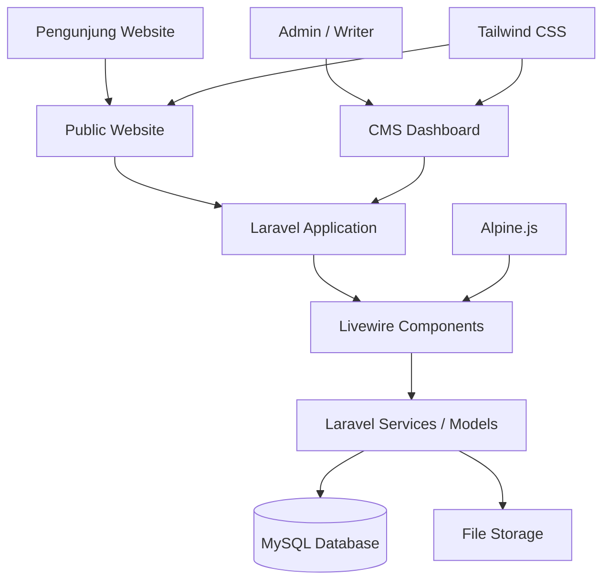
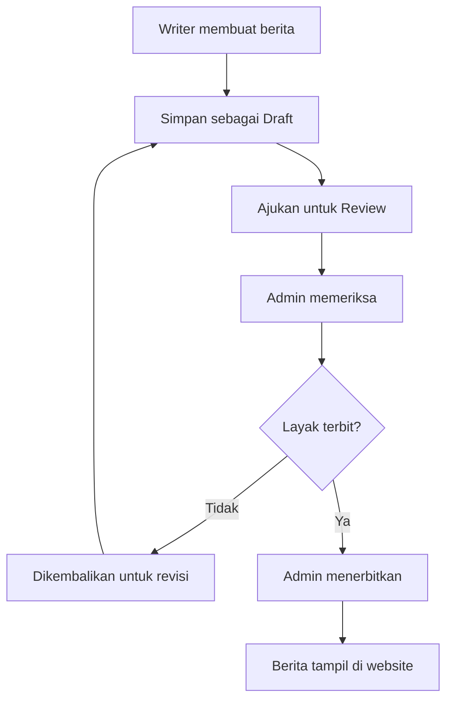
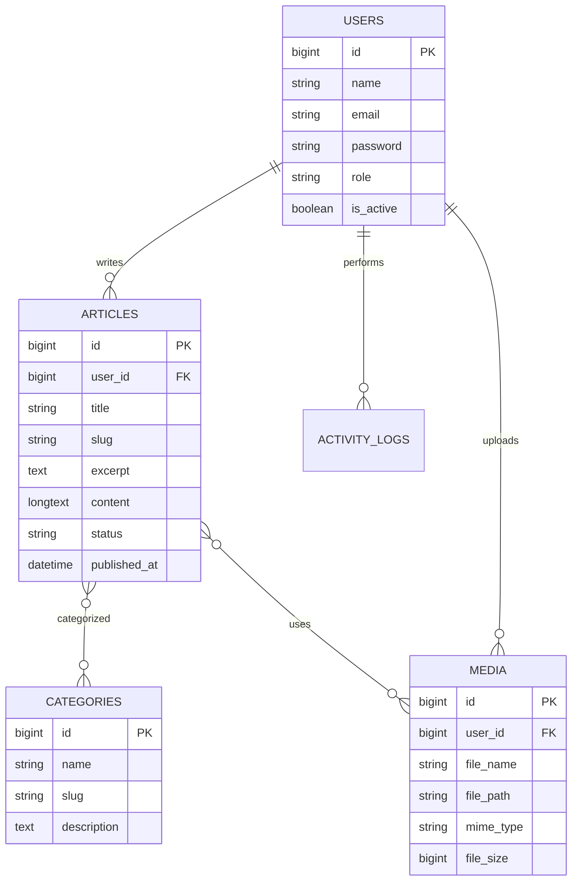

# PRODUCT REQUIREMENTS DOCUMENT (PRD)
# Website Resmi ICMI Kecamatan Caringin

**Nama produk:** ICMI Caringin – Official Website & News Management System  
**Versi:** 2.1  
**Tanggal:** November 2026  
**Masa bakti organisasi:** 2026–2031  
**Status dokumen:** Baseline kebutuhan produk

### Riwayat Revisi

| Versi | Tanggal | Perubahan |
|---|---|---|
| 2.0 | November 2026 | Baseline awal. |
| 2.1 | 2026-11-15 | Disetujui pemilik produk: (1) Writer dapat menerbitkan berita miliknya sendiri; penjadwalan tetap hanya Admin. (2) Admin berperan sebagai super admin. (3) Versi stack dikunci pada rilis stabil: Laravel 12.x, Livewire 3.x, Tailwind CSS 4.x, Alpine.js 3.x, PHP 8.3, MySQL 8.4 — dipilih agar stabil dijalankan dan mudah di-upgrade. |

---

## 1. Ringkasan Produk

### 1.1 Latar Belakang

ICMI Kecamatan Caringin membutuhkan website resmi sebagai pusat informasi dan publikasi organisasi. Website ini menjadi sarana untuk memperkenalkan identitas organisasi, menyampaikan visi dan misi, menampilkan struktur kepengurusan, serta mempublikasikan berita dan kegiatan kepada masyarakat.

Website dilengkapi Content Management System (CMS) agar pengelolaan profil dan berita dapat dilakukan oleh pengurus tanpa harus memiliki kemampuan pemrograman.

### 1.2 Visi Produk

Menjadi pusat informasi dan publikasi digital resmi ICMI Kecamatan Caringin yang profesional, mudah diakses, dan berkelanjutan.

### 1.3 Tujuan Produk

1. Menyediakan identitas digital resmi ICMI Kecamatan Caringin.
2. Menampilkan profil dan struktur kepengurusan masa bakti 2026–2031.
3. Menjadi media publikasi berita dan kegiatan organisasi.
4. Mempermudah pengelolaan konten melalui dashboard CMS.
5. Menyediakan alur penulisan, pemeriksaan, dan penerbitan berita.
6. Menyampaikan informasi organisasi kepada masyarakat secara terbuka.

### 1.4 Ruang Lingkup

**Termasuk (In Scope):**
- Website profil organisasi.
- Sejarah, visi, misi, tujuan, dan sambutan ketua.
- Struktur kepengurusan.
- Berita dan artikel.
- Kategori berita.
- Gambar utama dan foto pendukung berita.
- Galeri foto yang bersumber dari berita.
- Pencarian dan pagination berita.
- Dashboard CMS.
- Pengelolaan akun Admin dan Writer.
- Workflow penulisan dan publikasi.
- Pengaturan identitas website dan SEO dasar.

**Tidak termasuk (Out of Scope):**
- Database dan pendaftaran anggota.
- Administrasi surat.
- Manajemen keuangan.
- Monitoring program kerja.
- Manajemen rapat dan absensi.
- Sistem komunikasi internal anggota.
- Aplikasi mobile khusus.
- Portal layanan masyarakat.

---

## 2. Pengguna dan Hak Akses

Website memiliki tiga jenis pengunjung/pengguna: publik, Admin, dan Writer. Hanya Admin dan Writer yang memiliki akun internal.

### 2.1 Publik

Pengunjung tanpa login yang dapat:
- Melihat beranda dan profil organisasi.
- Melihat struktur kepengurusan.
- Membaca berita yang telah diterbitkan.
- Melihat kategori dan galeri foto berita.
- Mencari berita.
- Mengakses informasi kontak dan media sosial.

Publik tidak dapat mengakses dashboard atau konten yang belum diterbitkan.

### 2.2 Admin

Admin berperan sebagai super admin (pengelola utama) dengan kewenangan:
- Mengakses dashboard.
- Melihat dan mengelola seluruh berita.
- Membuat, mengedit, menghapus, mengarsipkan, menjadwalkan, dan menerbitkan berita.
- Memeriksa berita yang diajukan Writer.
- Mengelola kategori berita.
- Mengelola media.
- Mengelola profil organisasi.
- Mengelola struktur kepengurusan.
- Mengelola akun Writer.
- Mengatur identitas, kontak, SEO, dan konfigurasi website.
- Melihat aktivitas penting pengguna.

### 2.3 Writer

Writer bertugas membuat konten berita dengan kewenangan:
- Mengakses dashboard terbatas.
- Membuat berita.
- Mengedit berita miliknya.
- Mengunggah gambar berita.
- Memilih kategori yang tersedia.
- Menyimpan berita sebagai Draft.
- Mengajukan berita untuk diperiksa Admin.
- Memperbaiki berita yang dikembalikan untuk revisi.
- Melihat status berita miliknya.
- Menerbitkan berita miliknya sendiri.

Writer tidak dapat:
- Menjadwalkan berita.
- Mengedit atau menghapus berita milik Writer lain.
- Mengelola kategori.
- Mengubah profil organisasi dan struktur kepengurusan.
- Mengelola akun pengguna.
- Mengubah pengaturan website.

### 2.4 Matriks Hak Akses

| Fitur | Admin | Writer | Publik |
|---|:---:|:---:|:---:|
| Melihat website publik | Ya | Ya | Ya |
| Login dashboard | Ya | Ya | Tidak |
| Melihat dashboard | Penuh | Terbatas | Tidak |
| Membuat berita | Ya | Ya | Tidak |
| Mengedit berita sendiri | Ya | Ya | Tidak |
| Mengedit berita pengguna lain | Ya | Tidak | Tidak |
| Menghapus berita | Ya | Tidak | Tidak |
| Mengajukan berita untuk review | Opsional | Ya | Tidak |
| Menyetujui dan menerbitkan berita | Ya | Ya (berita sendiri) | Tidak |
| Mengelola kategori | Ya | Tidak | Tidak |
| Mengelola media | Penuh | Media milik sendiri/terkait | Tidak |
| Mengelola profil organisasi | Ya | Tidak | Tidak |
| Mengelola struktur pengurus | Ya | Tidak | Tidak |
| Mengelola pengguna | Ya | Tidak | Tidak |
| Mengelola pengaturan website | Ya | Tidak | Tidak |

Otorisasi harus diterapkan di backend menggunakan Laravel Policies/Gates atau mekanisme otorisasi setara. Menyembunyikan tombol di frontend saja tidak dianggap sebagai pengamanan.

---

## 3. Teknologi dan Arsitektur

### 3.1 TALL Stack

Aplikasi menggunakan TALL Stack:

- **T — Tailwind CSS:** styling dan responsive interface.
- **A — Alpine.js:** interaksi frontend ringan.
- **L — Laravel:** backend, routing, autentikasi, validasi, dan akses database.
- **L — Livewire:** komponen antarmuka dinamis yang terintegrasi dengan Laravel.

### 3.2 Teknologi Pendukung

| Komponen | Rekomendasi |
|---|---|
| Backend framework | Laravel, versi stabil yang kompatibel |
| CSS | Tailwind CSS |
| JavaScript | Alpine.js |
| Dynamic components | Livewire |
| Database | MySQL atau MariaDB |
| ORM | Eloquent |
| Authentication | Laravel authentication |
| Authorization | Policies/Gates |
| Rich text editor | TipTap atau editor setara |
| Image processing | Library pemrosesan gambar yang kompatibel |
| File storage | Local storage atau S3-compatible |
| Version control | Git |
| Deployment | VPS atau hosting yang mendukung Laravel |

Versi Laravel, Livewire, PHP, Node.js, dan dependensi lainnya harus dikunci berdasarkan matriks kompatibilitas resmi saat proyek dimulai. Jangan menggunakan versi yang tidak kompatibel.

### 3.3 Arsitektur Aplikasi

Aplikasi menggunakan satu backend Laravel dan satu database untuk website publik serta CMS.

### 3.4 Prinsip Arsitektur

1. Gunakan struktur Laravel yang standar dan mudah dipelihara.
2. Pisahkan area publik dan dashboard CMS.
3. Gunakan middleware untuk autentikasi.
4. Terapkan otorisasi pada setiap aksi sensitif.
5. Gunakan validasi server-side untuk seluruh input.
6. Gunakan Eloquent ORM dan relasi yang jelas.
7. Pisahkan file media dari data utama database.
8. Simpan konfigurasi rahasia melalui environment variables.
9. Gunakan Git untuk version control.
10. Hindari duplikasi logika bisnis pada komponen Livewire.

---

## 4. Struktur Navigasi dan Halaman

### 4.1 Navigasi Website Publik

- Beranda
- Profil Organisasi
- Struktur Kepengurusan
- Berita
- Galeri
- Kontak

Footer memuat identitas organisasi, alamat sekretariat, kontak resmi, tautan media sosial, dan informasi hak cipta.

### 4.2 Halaman Beranda

Komponen beranda:
1. Header dan navigasi.
2. Hero section berisi identitas ICMI Caringin.
3. Sambutan Ketua.
4. Profil singkat organisasi.
5. Berita unggulan.
6. Berita terbaru.
7. Kategori berita.
8. Galeri foto pilihan.
9. Informasi kontak.
10. Footer.

Konten beranda harus dikelola dari CMS sejauh relevan, bukan ditulis permanen di dalam kode.

### 4.3 Halaman Profil Organisasi

Memuat:
- Sejarah organisasi.
- Visi dan misi.
- Tujuan organisasi.
- Sambutan Ketua.
- Identitas dan logo organisasi.
- Informasi masa bakti kepengurusan.

### 4.4 Halaman Struktur Kepengurusan

Memuat:
- Ketua.
- Wakil Ketua.
- Sekretaris.
- Bendahara.
- Bidang-bidang.
- Nama dan foto pengurus.
- Jabatan dan deskripsi singkat.

Struktur kepengurusan harus dinamis dan dapat diperbarui Admin melalui CMS tanpa mengubah kode program.

### 4.5 Halaman Daftar Berita

Memuat:
- Berita terbaru.
- Berita unggulan.
- Kategori berita.
- Pencarian berita.
- Pagination.
- Gambar utama.
- Judul dan ringkasan.
- Tanggal publikasi.
- Nama penulis.

Hanya berita berstatus Published dan telah mencapai waktu publikasinya yang boleh tampil.

### 4.6 Halaman Detail Berita

Memuat:
- Judul berita.
- Gambar utama.
- Nama penulis.
- Tanggal publikasi.
- Kategori.
- Isi berita.
- Foto pendukung.
- Berita terkait.
- Tombol berbagi ke media sosial.

### 4.7 Halaman Galeri

Galeri menampilkan foto yang terkait dengan berita yang telah diterbitkan. Pada tahap pertama tidak diperlukan sistem galeri terpisah. Foto diambil dari media berita yang ditandai untuk ditampilkan di galeri.

### 4.8 Halaman Kontak

Memuat alamat sekretariat, email organisasi jika tersedia, nomor kontak resmi, dan tautan media sosial.

### 4.9 Navigasi Dashboard CMS

- Dashboard
- Manajemen Berita
- Kategori Berita
- Media Library
- Profil Organisasi
- Struktur Pengurus
- Manajemen Pengguna (Admin saja)
- Pengaturan Website (Admin saja)
- Audit Log (Admin saja, jika diaktifkan)

Menu dashboard harus menyesuaikan role pengguna.

---

## 5. Kebutuhan Fungsional

| Kode | Modul | Kebutuhan |
|---|---|---|
| FR-01 | Autentikasi | Login, logout, dan pengamanan sesi |
| FR-02 | Dashboard | Statistik konten dan aktivitas sesuai role |
| FR-03 | Berita | Membuat, membaca, mengedit, dan mengelola berita |
| FR-04 | Workflow | Draft, Review, Revision, Published, Scheduled, Archived |
| FR-05 | Kategori | Admin dapat mengelola kategori berita |
| FR-06 | Media | Upload, pilih, dan kelola gambar |
| FR-07 | Profil | Admin mengelola informasi organisasi |
| FR-08 | Pengurus | Admin mengelola struktur dan biodata pengurus |
| FR-09 | Pengguna | Admin membuat, mengubah, menonaktifkan akun Writer |
| FR-10 | Pengaturan | Admin mengelola identitas, kontak, SEO, dan media sosial |
| FR-11 | Publikasi | Menampilkan konten yang telah diterbitkan |
| FR-12 | Pencarian | Mencari berita berdasarkan judul dan isi |
| FR-13 | SEO | Slug, metadata, sitemap, dan Open Graph |
| FR-14 | Audit | Mencatat aktivitas penting pengguna |

### 5.1 Manajemen Berita

Setiap berita memiliki data:
- ID unik.
- Judul.
- Slug URL.
- Ringkasan.
- Konten.
- Gambar utama.
- Foto pendukung.
- Kategori.
- Penulis.
- Status.
- SEO title.
- SEO description.
- Waktu publikasi.
- Waktu dibuat dan diperbarui.

Ketentuan:
1. Slug harus unik.
2. Judul wajib diisi.
3. Konten wajib diisi sebelum diajukan.
4. Gambar harus divalidasi tipe dan ukurannya.
5. Writer hanya dapat mengelola berita miliknya.
6. Admin dapat mengelola seluruh berita.
7. Berita yang telah diterbitkan dapat diperbarui oleh Admin.
8. Perubahan status dan publikasi harus tercatat.

### 5.2 Workflow Publikasi

Status berita:
- **Draft:** masih dalam penulisan.
- **In Review:** menunggu pemeriksaan Admin.
- **Revision:** dikembalikan untuk diperbaiki.
- **Published:** telah dipublikasikan.
- **Scheduled:** dijadwalkan untuk diterbitkan.
- **Archived:** tidak lagi ditampilkan sebagai berita aktif.

Writer dapat menerbitkan berita miliknya sendiri, tetapi tidak dapat menjadwalkan berita. Admin berperan sebagai super admin: dapat menyetujui, menerbitkan, dan menjadwalkan seluruh berita, serta mengelola seluruh konten dan konfigurasi website.

### 5.3 Dashboard

Dashboard Admin menampilkan:
- Total berita.
- Berita Published.
- Berita Draft.
- Berita menunggu review.
- Berita terjadwal.
- Aktivitas terbaru.

Dashboard Writer menampilkan:
- Jumlah berita miliknya.
- Draft miliknya.
- Berita menunggu review.
- Berita yang perlu direvisi.
- Berita miliknya yang telah diterbitkan.

Angka dan statistik harus berasal dari database aktual, bukan data contoh.

### 5.4 Manajemen Kategori

Admin dapat:
- Membuat kategori.
- Mengedit kategori.
- Menghapus kategori yang tidak digunakan.
- Mengatur nama dan slug.
- Mengatur deskripsi kategori.

Kategori yang masih digunakan berita tidak boleh dihapus tanpa penanganan relasi, misalnya memindahkan berita ke kategori lain terlebih dahulu.

### 5.5 Media Library

Admin dapat mengelola seluruh media. Writer dapat mengunggah dan menggunakan media sesuai kewenangan yang ditentukan.

Ketentuan:
- Validasi MIME type dan ekstensi.
- Batas ukuran file dapat dikonfigurasi.
- Nama file dibuat aman dan unik.
- Gambar dioptimasi dan dapat dikonversi ke WebP.
- Simpan metadata media.
- Cegah penghapusan media yang masih digunakan.
- Batasi akses file yang tidak dimaksudkan untuk publik.

### 5.6 Profil Organisasi

Admin dapat mengelola:
- Nama organisasi.
- Logo.
- Sejarah.
- Visi.
- Misi.
- Tujuan.
- Sambutan Ketua.
- Masa bakti.
- Informasi kontak.
- Media sosial.

### 5.7 Struktur Kepengurusan

Admin dapat:
- Menambah dan mengedit data pengurus.
- Mengunggah foto.
- Menentukan jabatan.
- Mengelompokkan pengurus berdasarkan bagian atau bidang.
- Mengatur urutan tampilan.
- Mengaktifkan atau menonaktifkan tampilan pengurus.

Data yang disediakan:
- Nama.
- Jabatan.
- Bidang.
- Foto.
- Deskripsi singkat.
- Urutan tampilan.
- Status aktif.

### 5.8 Manajemen Pengguna

Admin dapat:
- Membuat akun Writer.
- Mengubah nama dan email.
- Mengatur ulang password.
- Menonaktifkan akun.
- Mengaktifkan kembali akun.
- Melihat aktivitas pengguna.

Tidak tersedia registrasi akun publik. Akun dibuat oleh Admin.

---

## 6. Rancangan Database

Database menggunakan MySQL/MariaDB dengan Eloquent ORM.

### 6.1 Daftar Tabel

| No. | Tabel | Fungsi |
|---:|---|---|
| 1 | users | Akun Admin dan Writer |
| 2 | articles | Berita dan artikel |
| 3 | categories | Kategori berita |
| 4 | article_category | Relasi berita dan kategori |
| 5 | media | Metadata gambar dan file |
| 6 | organization_profiles | Profil organisasi |
| 7 | management_members | Data pengurus |
| 8 | activity_logs | Riwayat aktivitas |
| 9 | settings | Konfigurasi website |

Tabel tambahan bawaan Laravel dapat digunakan sesuai kebutuhan, misalnya tabel cache, jobs, sessions, dan password reset tokens.

### 6.2 Relasi Utama

### 6.3 Aturan Database

1. Semua tabel memiliki primary key.
2. Email pengguna harus unik.
3. Slug berita dan kategori harus unik sesuai tabelnya.
4. Password wajib di-hash.
5. Relasi menggunakan foreign key.
6. Penghapusan berita menggunakan soft delete jika sesuai kebutuhan.
7. Data penulis tetap dapat ditelusuri apabila akun penulis dinonaktifkan.
8. Perubahan status berita dicatat.
9. Media yang sedang digunakan tidak boleh terhapus tanpa pemeriksaan relasi.
10. Gunakan timestamps untuk mencatat pembuatan dan perubahan data.

---

## 7. UI/UX dan Identitas Visual

### 7.1 Arah Desain

Desain harus mencerminkan karakter cendekiawan Muslim: intelektual, modern, bersahaja, profesional, dan terpercaya.

Palet warna awal:

| Warna | Hex | Penggunaan |
|---|---|---|
| Hijau tua | `#123B32` | Warna utama |
| Emas | `#D5B46A` | Aksen |
| Off-white | `#F7F8F5` | Latar utama |
| Charcoal | `#1F2937` | Teks utama |

Tipografi:
- Heading: Plus Jakarta Sans.
- Body: Inter.
- Navigasi: Inter Medium.

### 7.2 Prinsip UI/UX

1. Tampilan bersih dan tidak terlalu ramai.
2. Berita menjadi elemen visual utama.
3. Navigasi mudah dipahami.
4. Konsistensi komponen di seluruh halaman.
5. Mobile-first dan responsif.
6. Dashboard CMS memiliki layout yang jelas, sidebar, kartu statistik, tabel, form, dan komponen interaktif.
7. Berikan feedback yang jelas untuk loading, berhasil, gagal, validasi, dan status publikasi.
8. Gunakan kontras warna dan ukuran teks yang mudah dibaca.
9. Form memiliki label, petunjuk, dan pesan kesalahan yang jelas.
10. Hindari interaksi yang tidak diperlukan.

### 7.3 Halaman yang Harus Dirancang

**Website publik:**
- Beranda.
- Profil organisasi.
- Struktur kepengurusan.
- Daftar berita.
- Detail berita.
- Galeri.
- Kontak.

**CMS:**
- Login.
- Dashboard Admin.
- Dashboard Writer.
- Daftar berita.
- Form tambah/edit berita.
- Detail atau preview berita.
- Kategori.
- Media Library.
- Profil organisasi.
- Struktur pengurus.
- Manajemen pengguna.
- Pengaturan website.

UI/UX harus disetujui sebelum implementasi fitur utama dimulai.

---

## 8. SEO dan Performa

Website harus mudah ditemukan melalui mesin pencari.

Persyaratan:
- URL berita menggunakan slug yang mudah dibaca.
- Setiap berita memiliki meta title dan meta description.
- Open Graph untuk berbagi berita melalui WhatsApp dan media sosial.
- XML sitemap otomatis.
- Robots.txt.
- Canonical URL.
- Struktur heading yang benar.
- Optimasi gambar menggunakan WebP jika memungkinkan.
- Lazy loading gambar.
- Pagination pada daftar berita.
- Integrasi Google Search Console dan Google Analytics jika diperlukan.

---

## 9. Keamanan dan Kebutuhan Nonfungsional

| Aspek | Persyaratan |
|---|---|
| Autentikasi | Login aman |
| Password | Hash menggunakan mekanisme Laravel |
| Role | Admin dan Writer |
| Otorisasi | Laravel Policies/Gates |
| CSRF | Perlindungan bawaan Laravel |
| Validasi | Validasi server-side |
| Upload | Pembatasan MIME type, ukuran, dan ekstensi |
| XSS | Sanitasi konten HTML dari rich text editor |
| Backup | Database dan media |
| Audit | Pencatatan aktivitas penting |
| HTTPS | Wajib pada domain produksi |
| Performa | Optimasi query dan caching |
| Responsif | Desktop, tablet, dan smartphone |
| Aksesibilitas | Kontras dan navigasi yang layak |
| Pemeliharaan | Kode modular dan terdokumentasi |

Ketentuan keamanan tambahan:
- Setiap aksi sensitif harus memeriksa otorisasi di server.
- Akun yang dinonaktifkan tidak dapat login.
- Lindungi dashboard dari akses tanpa autentikasi.
- Batasi percobaan login dan terapkan mekanisme perlindungan yang sesuai.
- File upload tidak boleh dieksekusi sebagai kode.
- Gunakan HTTPS pada produksi.
- Simpan secret dan kredensial di environment variables.
- Lakukan backup dan uji pemulihan secara berkala.

---

## 10. Tahapan Pengembangan (Milestones)

Pengembangan dilakukan bertahap. Setiap milestone harus selesai dan lulus pengujian sebelum melanjutkan ke milestone berikutnya.

### Milestone 1 — Project Foundation

Pekerjaan:
- Setup Laravel dan TALL Stack.
- Konfigurasi database.
- Sistem login.
- Role Admin dan Writer.
- Layout dashboard.
- Layout website publik.
- Konfigurasi environment.

Hasil:
- Aplikasi dapat dijalankan.
- Admin dan Writer dapat login.
- Hak akses dasar berfungsi.
- Layout dasar publik dan CMS tersedia.

### Milestone 2 — UI/UX Implementation

Pekerjaan:
- Desain beranda.
- Desain profil organisasi.
- Desain struktur pengurus.
- Desain daftar dan detail berita.
- Desain dashboard CMS.
- Desain form dan tabel.

Hasil:
- Design system.
- Komponen UI reusable.
- Seluruh halaman utama memiliki desain yang disetujui.

### Milestone 3 — Content Management System

Pekerjaan:
- CRUD berita.
- Rich text editor.
- Kategori berita.
- Media Library.
- Workflow Draft, Review, Revision, Published.
- Hak akses Admin dan Writer.

Hasil:
- Writer dapat membuat dan mengajukan berita.
- Admin dapat memeriksa dan menerbitkan berita.
- Media dan kategori dapat dikelola.

### Milestone 4 — Organization Profile

Pekerjaan:
- Pengelolaan sejarah.
- Visi dan misi.
- Sambutan Ketua.
- Struktur pengurus.
- Kontak organisasi.
- Pengaturan identitas website.

Hasil:
- Seluruh konten profil dapat dikelola Admin melalui CMS.

### Milestone 5 — Public Website & SEO

Pekerjaan:
- Integrasi konten publik.
- Halaman berita.
- Detail berita.
- Pencarian dan kategori.
- Galeri foto.
- SEO dan optimasi performa.

Hasil:
- Website publik siap menampilkan informasi dan berita.
- Hanya konten yang telah diterbitkan yang dapat diakses publik.

### Milestone 6 — Testing & Deployment

Pekerjaan:
- Pengujian fungsional.
- Pengujian hak akses.
- Pengujian responsivitas.
- Pengujian keamanan.
- Backup dan pemulihan.
- Deployment domain.
- Pelatihan Admin dan Writer.

Hasil:
- Website siap digunakan.
- Domain dan HTTPS aktif.
- Admin dan Writer memahami pengelolaan CMS.
- Dokumentasi operasional tersedia.

---

## 11. Kriteria Penerimaan Produk

Produk dinyatakan siap digunakan apabila:

- [ ] Website publik dapat diakses tanpa login.
- [ ] Admin dapat login dan mengelola seluruh konten.
- [ ] Writer dapat membuat dan mengajukan berita.
- [ ] Writer hanya dapat menerbitkan berita miliknya sendiri.
- [ ] Writer tidak dapat mengedit berita milik Writer lain.
- [ ] Admin dapat menyetujui dan menerbitkan berita.
- [ ] Profil organisasi dapat dikelola melalui CMS.
- [ ] Struktur pengurus dapat diperbarui melalui CMS.
- [ ] Berita dapat ditampilkan berdasarkan kategori.
- [ ] Pencarian berita berfungsi.
- [ ] Gambar dapat diunggah dan dioptimasi.
- [ ] Website responsif pada smartphone.
- [ ] SEO dasar telah diterapkan.
- [ ] Hak akses dan keamanan telah diuji.
- [ ] Backup dan pemulihan data telah diuji.

---

## 12. Asumsi dan Hal yang Perlu Dikonfirmasi

Hal-hal berikut belum ditetapkan secara rinci dan harus dikonfirmasi sebelum atau selama tahap desain:

1. Logo resmi ICMI yang akan digunakan.
2. Alamat sekretariat dan kontak resmi.
3. Nama dan susunan lengkap pengurus masa bakti 2026–2031.
4. Sejarah, visi, misi, dan sambutan Ketua yang akan dipublikasikan.
5. Kategori berita yang akan digunakan.
6. Domain utama atau subdomain yang dipilih.
7. Hosting dan kapasitas penyimpanan media.
8. Identitas Admin pertama.
9. Kebijakan penulis berita dan format editorial.
10. Kebijakan privasi dan informasi kontak yang boleh ditampilkan.

Data yang belum tersedia tidak boleh diisi dengan informasi rekaan. Gunakan placeholder sampai data resmi diberikan.

---

## 13. Prinsip Eksekusi Proyek

1. Kerjakan satu milestone sampai selesai.
2. Jangan melanjutkan ke milestone berikutnya sebelum milestone sebelumnya lulus pengujian.
3. UI/UX harus disepakati sebelum coding fitur utama.
4. Jangan menambahkan fitur di luar PRD tanpa persetujuan.
5. Gunakan kode modular, reusable, dan mudah dipelihara.
6. Setiap perubahan harus diuji dan tidak merusak fitur sebelumnya.
7. Dokumentasikan keputusan teknis dan perubahan kebutuhan.
8. Pastikan seluruh konten publik telah mendapat persetujuan pihak yang berwenang.
9. Prioritaskan keamanan, kemudahan pengelolaan, dan keberlanjutan website.

---

## 14. Urutan Tahap Pekerjaan

Urutan pengembangan yang menjadi acuan:

**PRD → Database Design (ERD) → Sitemap & User Flow → UI/UX Design → Backend & Frontend Implementation → Testing → Deployment.**

PRD ini menjadi baseline kebutuhan produk untuk Website Resmi ICMI Kecamatan Caringin. Perubahan ruang lingkup, role, teknologi, atau fitur harus ditinjau dan disetujui sebelum diterapkan.
